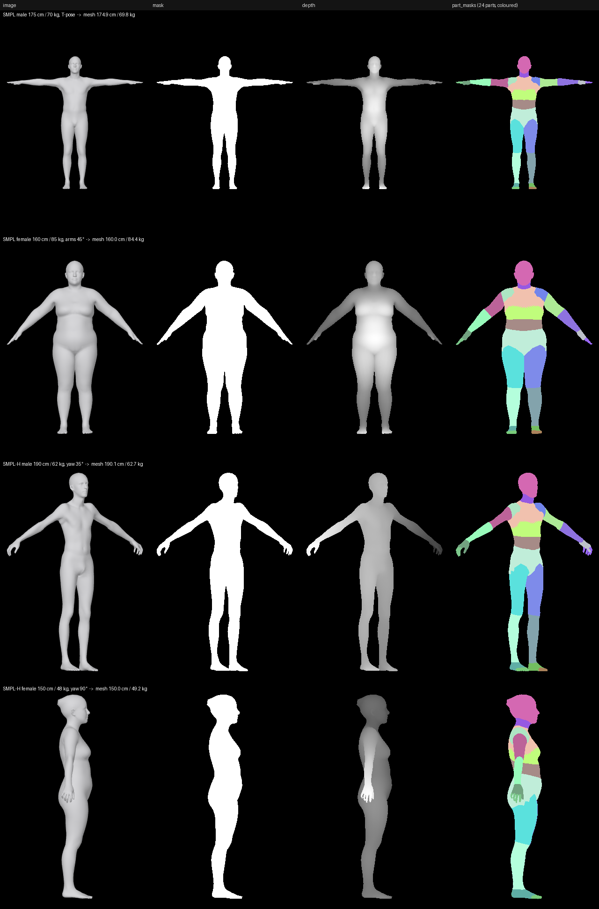
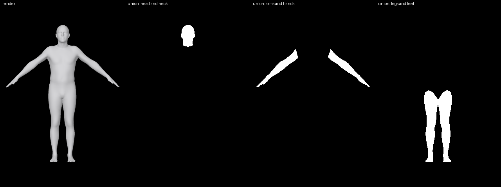
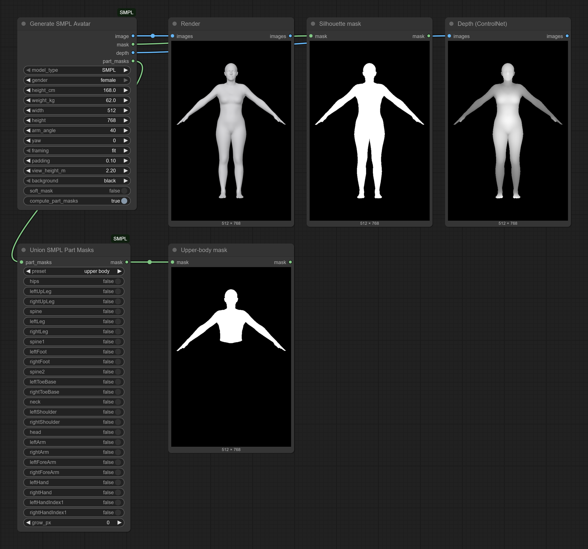
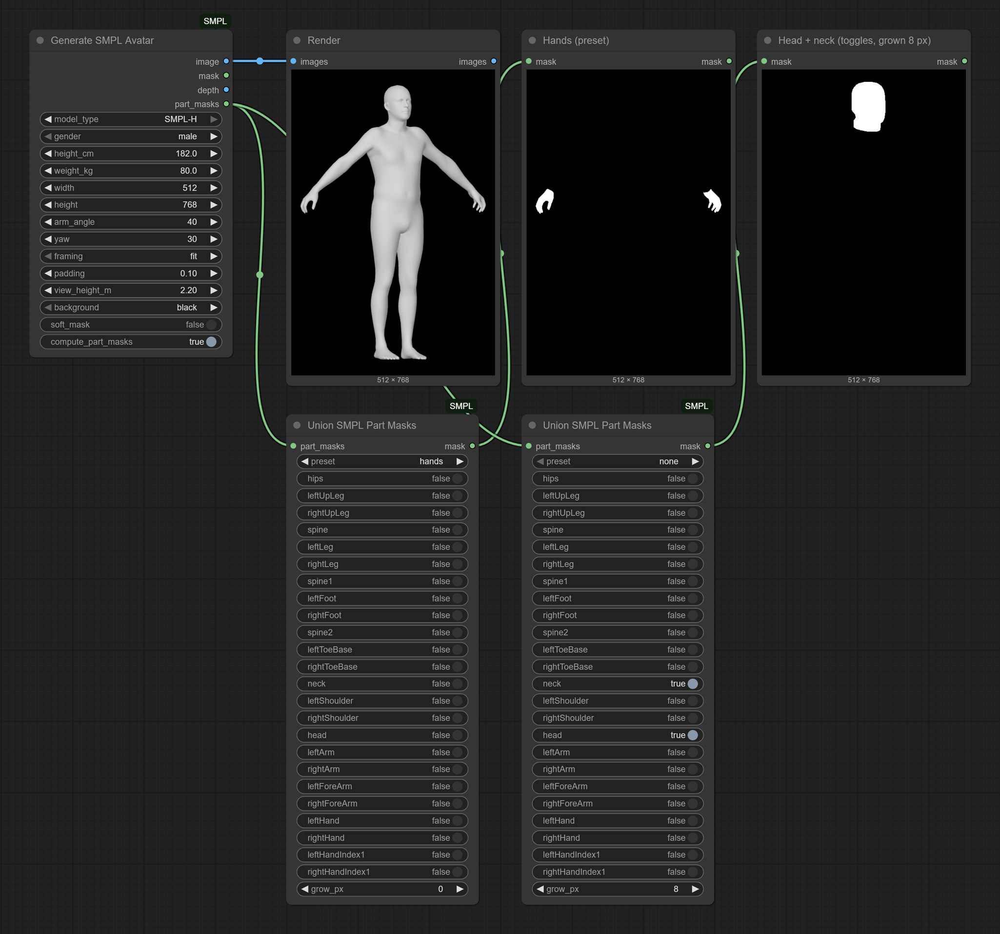

# ComfyUI-SMPL — SMPL Avatar nodes

ComfyUI nodes that build an **SMPL** or **SMPL-H** body from a **height and a
weight**, render it with an orthographic camera, and output maps that can be
used directly as ControlNet-style conditioning:

- a shaded render (`IMAGE`),
- the silhouette as a `MASK`, computed from the exact render coverage,
- a depth map (`IMAGE`, near = white),
- 24 per-body-part masks (`MASK`), plus a node that unions any selection of parts.

> **Licensing in one paragraph.** The code in this repository is MIT-licensed.
> It depends on the SMPL / SMPL-H body models and on the `smplx` package, which
> are **not** MIT: both are distributed by the Max Planck Institute for
> Intelligent Systems under **non-commercial research licenses**, and the model
> files cannot be redistributed. Every user must download the models from the
> official websites and accept their license. Commercial use of SMPL requires a
> license from Meshcapade / Max Planck. See [Licensing](#licensing) and
> [THIRD_PARTY_NOTICES.md](THIRD_PARTY_NOTICES.md).



*Four bodies generated from a height and a weight (the caption of each row
gives the request and the measurements of the resulting mesh). Rendered from
the SMPL / SMPL+H models, © Max-Planck-Gesellschaft, shown for illustration
under their non-commercial license; see [docs/README.md](docs/README.md).*

## Nodes

### Generate SMPL Avatar (`SMPLAvatarGenerate`)

| Input | Type | Description |
|---|---|---|
| `model_type` | `SMPL` / `SMPL-H` | Body only, or body with articulated hands (relaxed hand pose). |
| `gender` | `male` / `female` | Selects the gendered model. |
| `height_cm`, `weight_kg` | FLOAT | Target body measurements (see [Shape regressor](docs/TECHNICAL.md#shape-regressor)). |
| `width`, `height` | INT | Output size in pixels. |
| `arm_angle` *(optional)* | FLOAT | Lowers both arms from the T-pose (0 = T-pose, ~45 = A-pose). |
| `yaw` *(optional)* | FLOAT | Rotation about the vertical axis in degrees (90 = right profile). |
| `framing` *(optional)* | `fit` / `fixed` | `fit` fills the image; `fixed` keeps a constant metres-per-pixel scale so different heights stay comparable, and cuts whatever lies outside the view (a warning is logged). |
| `padding` *(optional)* | FLOAT | Margin around the body (`fit`) or below the feet (`fixed`). |
| `view_height_m` *(optional)* | FLOAT | Height of the view in metres for `fixed` framing. The view is `view_height_m` × `width` / `height` metres wide (1.47 m at 512 × 768), so raise it, or lower the arms, when the body is cut. |
| `background` *(optional)* | `black` / `white` / `gray` | Background of the shaded render. |
| `soft_mask` *(optional)* | BOOLEAN | Anti-aliased masks (exact per-pixel coverage) instead of binary ones. |
| `compute_part_masks` *(optional)* | BOOLEAN | Render the 24 part masks (needs the part segmentation, downloaded on first use). |

| Output | Type | Description |
|---|---|---|
| `image` | IMAGE `[1,H,W,3]` | Shaded render composited over the background. |
| `mask` | MASK `[1,H,W]` | Silhouette, 1 = body. |
| `depth` | IMAGE `[1,H,W,3]` | Nearest point 1.0, farthest fully covered body point 0.2, background 0 (edge pixels scaled by coverage with `soft_mask`). |
| `part_masks` | MASK `[24,H,W]` | One mask per SMPL part, in SMPL joint order. The 24 masks are disjoint and their sum equals `mask` (all zeros when `compute_part_masks` is off). |

### Union SMPL Part Masks (`SMPLAvatarPartMaskUnion`)



Takes `part_masks` and returns one `MASK` `[1,H,W]`: the union of the parts
selected by a `preset` (head, torso, arms, hands, legs, feet, upper body,
lower body, full body, ...) and/or the 24 individual toggles. `grow_px` dilates
(positive) or erodes (negative) the result. A batch of `24·N` masks from `N`
avatars gives `N` output masks.

The 24 parts and their order are listed in
[docs/TECHNICAL.md](docs/TECHNICAL.md#body-parts).

## Example workflows

Both workflows are in [`example_workflows/`](example_workflows) and in
ComfyUI's template browser once the pack is installed (*Templates* in the
left sidebar, under *Extensions → ComfyUI-SMPL*; searching "smpl" finds
them). Masks are displayed with ComfyUI's built-in *Preview Mask* node, so no
other node pack is needed.

### Render, silhouette, depth and a part mask

[`smpl_avatar_maps.json`](example_workflows/smpl_avatar_maps.json): one
*Generate SMPL Avatar* node feeds *Preview Image* / *Preview Mask* nodes with
the render, the silhouette and the depth map, and a *Union SMPL Part Masks*
node with the `upper body` preset.



### Part masks from a preset or from the toggles

[`smpl_avatar_part_masks.json`](example_workflows/smpl_avatar_part_masks.json):
an SMPL-H body seen from a three-quarter view (`yaw` = 30) and two *Union SMPL
Part Masks* nodes: one uses the `hands` preset, the other selects `head` and
`neck` with the toggles and dilates the result by 8 pixels (`grow_px`).



*The screenshots contain renders of the SMPL / SMPL+H models,
© Max-Planck-Gesellschaft, shown for illustration under their non-commercial
license; see [docs/README.md](docs/README.md).*

## Installation

1. Put the pack in `ComfyUI/custom_nodes/`: `git clone
   https://github.com/corentineuvrard/ComfyUI-SMPL` there, or download the
   ZIP from GitHub and extract it there (rename `ComfyUI-SMPL-main` to
   `ComfyUI-SMPL`), or install it with ComfyUI-Manager (*Install via Git
   URL*), which also runs step 2.
2. Install the requirements with the Python that runs ComfyUI, then start or
   restart ComfyUI:

   ```bash
   cd ComfyUI/custom_nodes/ComfyUI-SMPL
   pip install -r requirements.txt
   ```

   Windows portable build: open a command prompt in the
   `ComfyUI_windows_portable` folder (the one with `run_nvidia_gpu.bat`) and run
   `python_embeded\python.exe -m pip install -r ComfyUI\custom_nodes\ComfyUI-SMPL\requirements.txt`.

   This adds `smplx`, `pyglet` and `trimesh`; ComfyUI's own PyOpenGL and
   torch are left as they are (the renderer, pyrender, is included in the
   pack: see [why](docs/TECHNICAL.md#the-vendored-pyrender)).
3. Install the body model files (next section). They are loaded on first use,
   so ComfyUI does not need another restart.

The nodes appear under the **SMPL Avatar** category. The first run takes
10–20 s: the pack fits the height/weight regressor from your model files,
downloads the 110 KB part segmentation from GitHub (see
[offline use](docs/TECHNICAL.md#part-segmentation)) and starts its render
worker. Later runs take well under a second.

## Body model files

The SMPL and SMPL-H files are **not** included: each user downloads them.

| Model | Where | What to download |
|---|---|---|
| SMPL | https://smpl.is.tue.mpg.de | The "SMPL for Python" archive (e.g. `SMPL_python_v.1.1.0.zip`), which contains the male and female models `basicmodel_{m,f}_lbs_10_207_0_v1.x.0.pkl` |
| SMPL-H | https://mano.is.tue.mpg.de | The "Models & Code" archive (e.g. `mano_v1_2.zip`), which contains `SMPLH_male.pkl`, `SMPLH_female.pkl`, `MANO_LEFT.pkl` and `MANO_RIGHT.pkl` |

Both sites require registration and acceptance of a non-commercial license.

The official files contain `chumpy` objects, and the SMPL-H files lack the
MANO hand parameters `smplx` expects; the script below fixes both without
chumpy (NumPy only), reading the downloaded zip archives directly:

```bash
python scripts/prepare_models.py --source path/to/downloads
```

(Windows portable build, from the `ComfyUI_windows_portable` folder:
`python_embeded\python.exe ComfyUI\custom_nodes\ComfyUI-SMPL\scripts\prepare_models.py --source ...`.)

It writes the files to the pack's own `models/` folder, where the node finds
them without any further configuration (`--output <folder>` writes them
elsewhere, `--force` replaces existing files):

```
ComfyUI-SMPL/models/
├── smpl/SMPL_MALE.pkl, SMPL_FEMALE.pkl
└── smplh/SMPLH_MALE.pkl, SMPLH_FEMALE.pkl
```

The node also looks in `ComfyUI/models/body_models/` (same layout) and in
the folders listed in `SMPL_AVATAR_MODEL_DIR`; details in
[docs/TECHNICAL.md](docs/TECHNICAL.md#where-the-model-files-are-searched).

**Trust note.** The `.pkl` model files are Python pickles, which can execute
code when loaded: only use files you downloaded from the official sites
yourself (or produced from them with `scripts/prepare_models.py`).

## Configuration

| Variable | Effect |
|---|---|
| `SMPL_AVATAR_MODEL_DIR` | Extra folder(s) searched for body model files. |
| `SMPL_AVATAR_NO_DOWNLOAD=1` | Never download the part segmentation. |
| `SMPL_AVATAR_RENDER_PROCESS` | `auto` (default), `worker` or `inprocess`. |
| `SMPL_AVATAR_RENDER_TIMEOUT` | Seconds to wait for one worker reply (default 300; 0 = no limit). |
| `SMPL_AVATAR_GL_PLATFORM` | `PYOPENGL_PLATFORM` for the render worker (`egl`, `osmesa`, ...; `default` = unset). |
| `PYOPENGL_PLATFORM` | Never overridden; see [the OpenGL platform notes](docs/TECHNICAL.md#opengl-platform-and-headless-linux) (an empty value counts as unset). |
| `SMPL_AVATAR_REQUIRE_GL=1` | Tests only: fail instead of skipping rendering tests when no OpenGL context can be created. |

Windows portable build: add one `set NAME=value` line per variable above the
`python_embeded` line of `run_nvidia_gpu.bat` (or `run_cpu.bat`), for
example `set SMPL_AVATAR_MODEL_DIR=D:\body_models`.

## Licensing

- **This repository's code**: MIT, © 2026 Corentin Euvrard ([LICENSE](LICENSE)).
  `LICENSE` is the plain MIT text; what it does and does not cover is
  spelled out in [THIRD_PARTY_NOTICES.md](THIRD_PARTY_NOTICES.md).
- **Vendored pyrender** (`smpl_avatar/_vendor/pyrender`): MIT, © 2019 Matthew
  Matl; see its `LICENSE` file and [THIRD_PARTY_NOTICES.md](THIRD_PARTY_NOTICES.md).
- **smplx** (runtime dependency, installed from PyPI): Max Planck
  "Software Copyright License for non-commercial scientific research
  purposes". It is not an open-source license, and using this pack means
  using smplx under those terms.
- **SMPL, SMPL-H, MANO model files**: Max Planck non-commercial licenses; each
  user downloads them and accepts the license; redistribution is not allowed.
  Commercial licensing of SMPL is available through Meshcapade.
- **Part segmentation**: published by Meshcapade without a stated license;
  downloaded by each user, not redistributed.
- **Shape regressor coefficients**: derived from the user's own SMPL files on
  the user's machine; not distributed.

In short, the MIT licenses apply to this code only; they do not make the
SMPL stack as a whole usable for commercial purposes. Please cite SMPL
(Loper et al., 2015) and, for SMPL-H, MANO (Romero et al., 2017) in
publications — see [THIRD_PARTY_NOTICES.md](THIRD_PARTY_NOTICES.md).

## Technical notes

How the height/weight regressor is fitted and how accurate it is, how the
maps are rendered (worker process, masks, depth, part segmentation), the
OpenGL platform policy for headless Linux, the tested versions and the
development notes are in [docs/TECHNICAL.md](docs/TECHNICAL.md).
